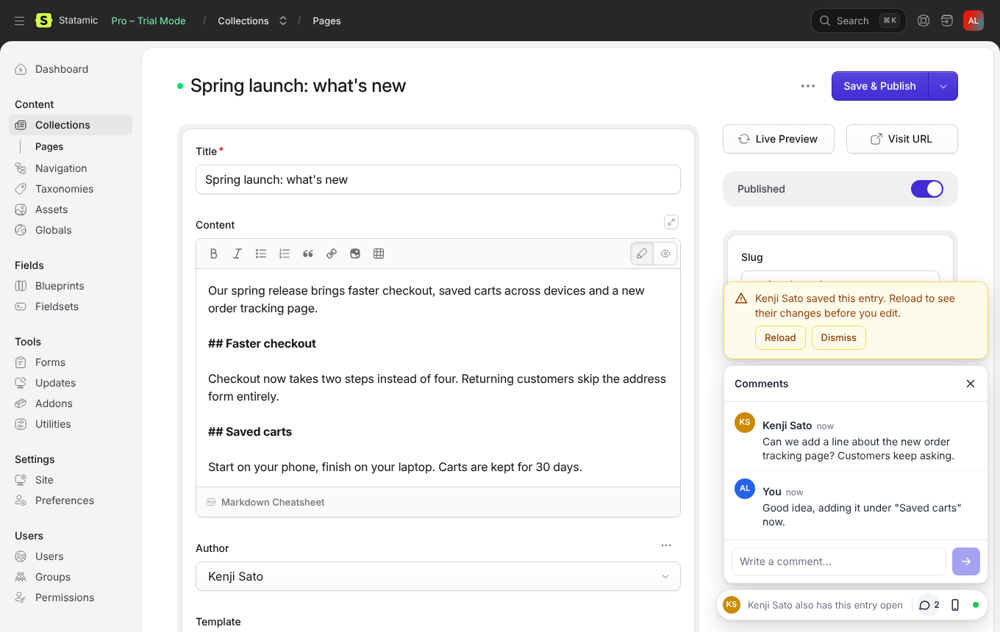
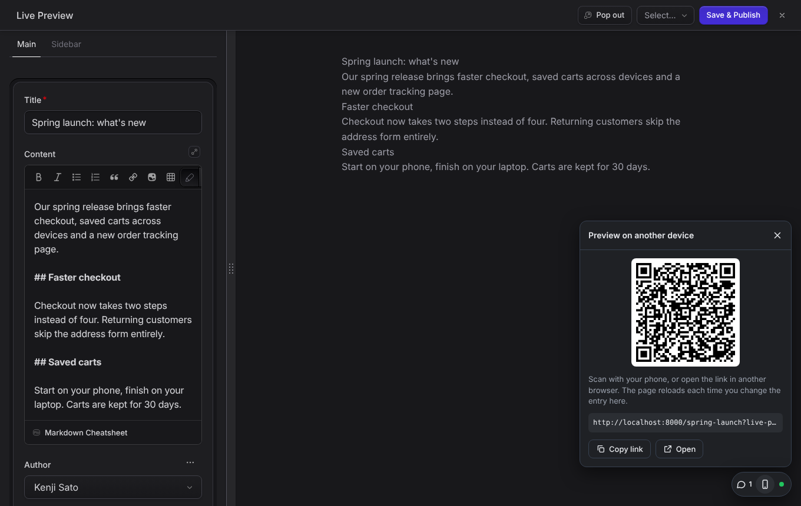

# hibira-io/statamic

[](https://github.com/hibira-io/statamic/actions/workflows/ci.yml)

Realtime teamwork for the [Statamic](https://statamic.com) control panel, on
[Hibira](https://hibira.io):

- **Who else is here.** The avatars of everyone who has the same entry open,
  and a warning the moment one of them saves it, so nobody keeps editing an
  old version.
- **Live comments.** Leave a question or a note on an entry. Everyone who has
  it open sees new comments as they are written; resolve them when they are
  done. Reviewers who may only view an entry can comment too.
- **Live preview on any device.** Scan a QR code to open your live preview on
  your phone, or send the link to another browser. The page reloads every
  time you change the entry, and keeps its scroll position.

Works with Statamic 5 and 6, flat file or database. Comments need no
database, and there is nothing to publish or build.



## Install

```sh
composer require hibira-io/statamic
php artisan hibira:install
```

`hibira:install` (from [hibira-io/laravel](https://github.com/hibira-io/laravel))
adds the `HIBIRA_*` settings to `.env`. Copy the app ID, key and secret from
your app page on [hibira.io/portal](https://hibira.io/portal) (the free plan
needs no card), and check them with `php artisan hibira:check`.

On the same app page, add your site's address (for example
`https://example.com`) to **Allowed origins**, so the control panel and
preview pages may connect.

Open an entry in two browsers, signed in as two users. The dock appears in
the bottom right corner.



## What it does

| | |
| --- | --- |
| Avatars | Everyone with the entry's edit page open. Hover for the name. |
| Saved warning | When someone else saves the entry, a card asks you to reload before you edit. Saves from the console (imports, scheduled publishing) are left out. |
| Comments | Plain text, up to 2,000 characters. Ctrl+Enter sends. Anyone who may view the entry can comment and resolve; the author or a super user can delete. |
| Live preview link | Open Live Preview on the entry once, then press the phone button for the QR code and link. The link works as long as Statamic's live preview token. |

People see only entries they may view: every channel subscription and
comment request is checked against Statamic's own permissions.

In English, 繁體中文, 简体中文, 日本語, 한국어, ไทย and Tiếng Việt, following
each user's control panel language.

## Options

Publish the config to change them:

```sh
php artisan vendor:publish --tag=hibira-statamic-config
```

| Setting | Default | |
| --- | --- | --- |
| `presence` | `true` | Avatars and saved warnings (`HIBIRA_STATAMIC_PRESENCE`) |
| `comments.enabled` | `true` | Comments (`HIBIRA_STATAMIC_COMMENTS`) |
| `comments.path` | `storage/statamic/hibira-comments` | One JSON file per entry. Point it inside `content/` to keep comments in git with your content. |
| `comments.max_length` | `2000` | Characters per comment |
| `live_preview` | `true` | Live preview on other devices (`HIBIRA_STATAMIC_LIVE_PREVIEW`) |
| `control_panel_echo` | `true` | See below (`HIBIRA_STATAMIC_CP_ECHO`) |

### Statamic's own broadcasting

Statamic's control panel has its own Echo client, which addons such as
[statamic/collaboration](https://github.com/statamic/collaboration) use.
Statamic only knows how to point it at Pusher or Reverb. With
`BROADCAST_CONNECTION=hibira`, this addon fills in the Hibira host, so those
addons run on Hibira with no more setup. That client opens a connection on
every control panel page, so set `HIBIRA_STATAMIC_CP_ECHO=false` if you
don't use such an addon.

## How it uses Hibira

- Each entry has a presence channel. The control panel signs subscriptions
  on its own route, for users who may view the entry, so you don't have to
  change your app's broadcasting setup.
- Comments are stored first, then sent to the others on the entry's channel.
  A page that lost its connection fetches them again when it reconnects.
- A live preview page opened outside the control panel listens on a public
  channel named after a keyed hash of its preview token, so only someone with
  the link can find it, and its events carry no content. Events are sent only
  while such a page is open.
- Each open edit page is one connection, and each preview page opened on
  another device is one more.

## Testing

```sh
composer test
```

The browser code is in `resources/js`. After changing it, rebuild `dist/`
with `npm ci && npm run build`.

## License

MIT

## 中文摘要

在 Statamic 控制台加上即時協作：同一篇內容誰也開著（頭像），有人儲存時立刻提醒重新載入；
即時留言（可標記已解決，只能看不能改的審稿人也能留言）；用手機掃 QR Code 開即時預覽，
每次修改內容手機頁面就自動重新載入。支援 Statamic 5 與 6，留言存成 JSON 檔不需要資料庫。
安裝：`composer require hibira-io/statamic`，`php artisan hibira:install` 填入
[hibira.io/portal](https://hibira.io/portal) 的 App ID、Key、Secret，並把網站網址加到 Allowed origins。
